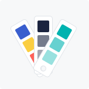
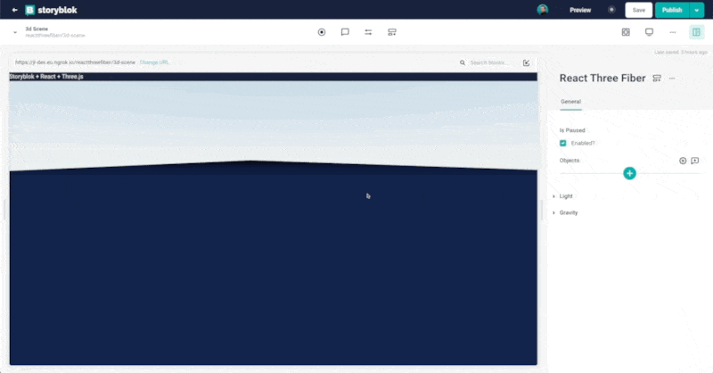

<p style="text-align: center">
  <a href="https://www.storyblok.com/" rel="noopener">
 </a>
</p>

<h1>

Palette Field Type
</h1>

| Name    | Description                                  | Author                                                                                                    |
| ------- | -------------------------------------------- | --------------------------------------------------------------------------------------------------------- |
| Palette | Allow users to select a color from a palette | [Johannes Lindgren](https://github.com/johannes-lindgren) & [Alba Silvente](https://github.com/Dawntraoz) |

A custom field-type for Storyblok that allow users to select a color from a palette.



## Getting Started

```bash
# install dependencies
yarn install

# start the dev server and open the printed Sandbox link
yarn dev

# run the tests
yarn test

# deploy the plugin using our @storyblok/field-plugin-cli
yarn deploy
```

`yarn deploy` asks for your [personal access token](https://app.storyblok.com/#/me/account?tab=token), the plugin's name, and where to add it (My Plugins or Partner Portal).

## Upgrading from the Vue 2 version

This plugin now uses Vue 3 and [@storyblok/field-plugin](https://www.storyblok.com/docs/plugins/field-plugins). The way you build and deploy it has changed:

- There is no `dist/export.js` to paste into the field-type editor anymore. Deploy with `yarn deploy` instead.
- To update an existing plugin, deploy with the same name and choose to update it, for example `yarn deploy --name <your-plugin-name>`.
- During the update, the CLI asks whether the options from `field-plugin.config.json` should replace the plugin options. Answer **Yes**. The option values you set on your fields stay the same.
- Content saved by the Vue 2 version still works. The content shape (`plugin`, `value`) has not changed.

# App Description

Select a color from a customizable set with the Palette field plugin. The palette is ideal for settings colors for
buttons, headers, and backgrounds.

## How to set up

In the block library, select a block to edit. Add a new field, set the _Field Type_ to _Plugin_, and set the _Custom
Type_ to `storyblok-palette`.

Configure the options:

- `colors`: A JSON encoded array of hex color strings. For example:

```json
[
  "#00B3B0",
  "#40C6C4",
  "#7FD9D7",
  "#D9F4F3",
  "#1B243F",
  "#545B6F",
  "#8D919F",
  "#C6C8CF",
  "#B1B5BE",
  "#DFE3E8",
  "#E7EAEE",
  "#EFF1F3",
  "#2DB47D",
  "#62C79E",
  "#96D9BE",
  "#CAECDE",
  "#395ECE",
  "#6B87DB",
  "#9CAEE6",
  "#CDD7F3",
  "#FBCE41",
  "#FCDB71",
  "#FDE6A0",
  "#FEF3CF",
  "#FFAC00",
  "#FFC140",
  "#FFD57F",
  "#FFEABF",
  "#FF6159",
  "#FF8983",
  "#FFB0AC",
  "#FFD7D5"
]
```

- `defaultValue` (optional): One of the values in `color` without the quotes. For example `#00B3B0`.
- `size` (optional): `small`, `medium`, or `large`

Example output:

```json
{
  "plugin": "jl-dev",
  "value": "#DFE3E8"
}
```

If the `defaultValue` option is not defined, the user can de-select the color. In this case, the value from the field
type will be `undefined`. If the `defaultValue` is defined, the user will not be able to de-select the color.
