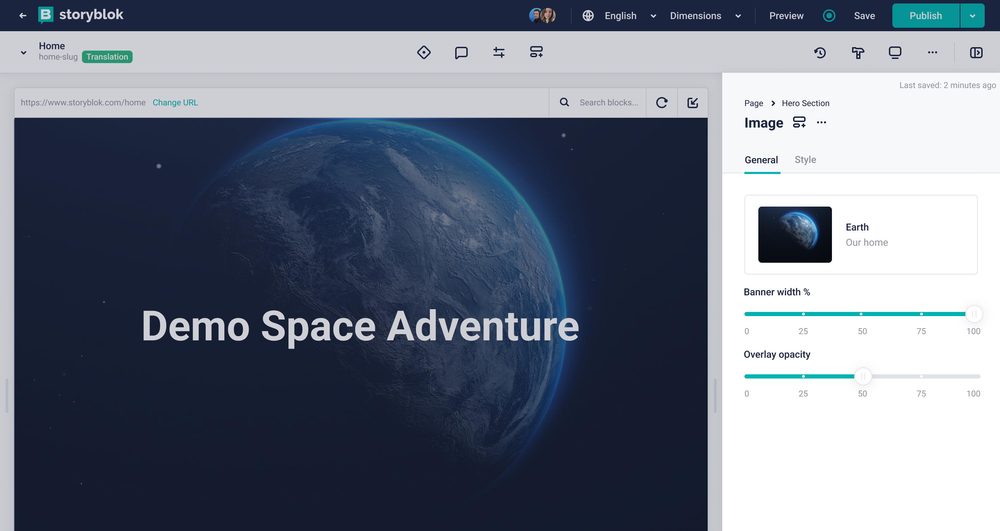
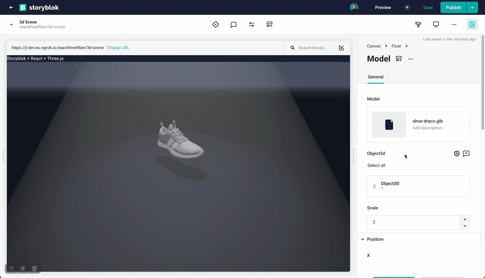

<p style="text-align: center">
  <a href="https://www.storyblok.com/" rel="noopener">
 </a>
</p>

<h1>

Slider Field Plugin
</h1>

| Name   | Description                                       | Author                                                    |
| ------ | ------------------------------------------------- | --------------------------------------------------------- |
| Slider | Allow users to select a number value from a range | [Johannes Lindgren](https://github.com/johannes-lindgren) |

A field plugin for Storyblok that allow users to select a number value from a range.





## Getting Started

```bash
# install dependencies
yarn install

# start the dev server and open the printed Sandbox link
yarn dev

# run the tests
yarn test

# deploy the plugin using our @storyblok/field-plugin-cli
yarn deploy
```

`yarn deploy` asks for your [personal access token](https://app.storyblok.com/#/me/account?tab=token), the plugin's name, and where to add it (My Plugins or Partner Portal).

## Upgrading from the Vue 2 version

This plugin now uses Vue 3 and [@storyblok/field-plugin](https://www.storyblok.com/docs/plugins/field-plugins). The way you build and deploy it has changed:

- There is no `dist/production.js` to paste into the field plugin editor anymore. Deploy with `yarn deploy` instead.
- To update an existing plugin, deploy with the same name and choose to update it, for example `yarn deploy --name <your-plugin-name>`.
- During the update, the CLI asks whether the options from `field-plugin.config.json` should replace the plugin options. Answer **Yes**. The option values you set on your fields stay the same.
- Content saved by the Vue 2 version still works. The content shape (`plugin`, `value`) has not changed.

# App Description

Select a value within a range using the Slider field plugin. Sliders are ideal for setting properties such as opacity, brightness, percentages, and ratios.

## How to set up

In the Block Library, select a block to edit. Add a new field, set the _Field Type_ to _Plugin_, and set the _Custom Type_ to `storyblok-slider`.

Configure the options:

- `minValue`: (optional) The minimum value of the slider's range. Defaults to `0`.
- `maxValue`: (optional) The maximum value of the slider's range. Defaults to `100`.
- `defaultValue`: (optional) The starting position of the slider. This number must be within the range. Defaults to `minValue`.
- `marks`: (optional) A JSON array of numbers. The numbers must be within the range. For each value in this array, a mark will be shown, together with a label for the value. For example, for the range `[-10, 10]`, you can use the the marks `[-5, 0, 5]`.
- `stepSize`: (optional) The minimum distance between points on the scale. To disable it, set the stepSize to `0`. Defaults to `1`.

The options for label formatting affects how the field is rendered, but does not change the output. These options are passed as properties to [Intl.NumberFormat](https://developer.mozilla.org/en-US/docs/Web/JavaScript/Reference/Global_Objects/Intl/NumberFormat/NumberFormat#syntax). If any of the formatting options are invalid, the formatting will be disabled.

- `minimumSignificantDigits`: (optional) The minimum number of significant digits to use. Possible values are from 1 to 21; the default is 1.
- `maximumSignificantDigits`: (optional) The maximum number of significant digits to use. Possible values are from 1 to 21; the default is 21.
- `style`: (optional) The formatting style to use. If the `style` is `unit`, the `unit` _property_ must be provided. The default is `decimal`. The following values are allowed:
  - `decimal`
  - `percent`
  - `unit`
- `unit`: (optional) [core unit identifiers](https://unicode.org/reports/tr35/tr35-general.html#Unit_Elements) to use in unit formatting. Pairs of units can be concatenated with `-per-` to make a compound unit; for example, `kilobit-per-second`. The following values are allowed:
  - `acre`
  - `bit`
  - `byte`
  - `celsius`
  - `centimeter`
  - `day`
  - `degree`
  - `fahrenheit`
  - `fluid-ounce`
  - `foot`
  - `gallon`
  - `gigabit`
  - `gigabyte`
  - `gram`
  - `hectare`
  - `hour`
  - `inch`
  - `kilobit`
  - `kilobyte`
  - `kilogram`
  - `kilometer`
  - `liter`
  - `megabit`
  - `megabyte`
  - `meter`
  - `mile`
  - `mile-scandinavian`
  - `milliliter`
  - `millimeter`
  - `millisecond`
  - `minute`
  - `month`
  - `ounce`
  - `percent`
  - `petabyte`
  - `pound`
  - `second`
  - `stone`
  - `terabit`
  - `terabyte`
  - `week`
  - `yard`
  - `year`

### Examples

Rotation with a default value, discrete steps, marks, and custom formatting:

```
minValue: -180
maxValue: 180
stepSize: 5
marks: [-90, 0, 90]
style: unit
unit: degree
```


Format a value between 0 and 1 as a percentage:

```
minValue: 0
maxValue: 1
stepSize: 0.01
style: percent
```


Format with unit and custom significant digits:

```
minValue: 0
maxValue: 1000
stepSize: 0
minimumSignificantDigits: 2
maximumSignificantDigits: 2
style: unit
unit: gigabit-per-second
```


